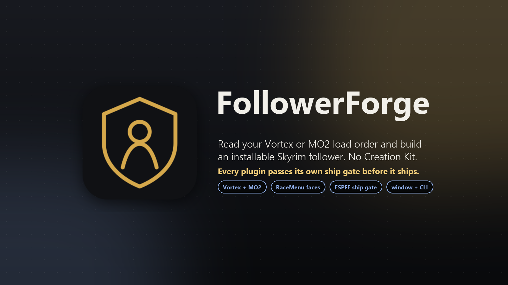
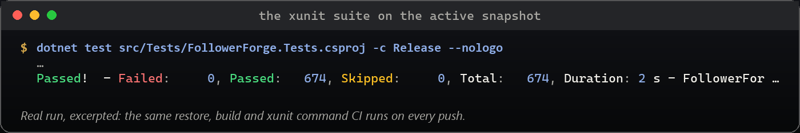

<div align="center">



[](https://github.com/SenjuWoo/FollowerForge/actions/workflows/ci.yml)
[](https://github.com/SenjuWoo/FollowerForge/releases/latest)
[](FollowerForge%203.9.0/src/Directory.Build.props)
[](#requirements)
[](LICENSE)

**[Download](https://github.com/SenjuWoo/FollowerForge/releases/latest)** · **[Quick start](#quick-start)** · **[Your followers](#your-followers)** · **[Command line](#command-line)** · **[How it works](#how-it-works)** · **[Status](docs/STATUS.md)** · **[Changelog](CHANGELOG.txt)**

</div>

FollowerForge is a Windows app that builds custom Skyrim SE/AE followers without the Creation
Kit. It reads the load order you already have in Vortex or Mod Organizer 2: every race, voice,
outfit, armour piece and place your mods add. You pick who she is, how she looks, sounds, fights,
dresses and where she waits. It writes an ESPFE follower plugin with her RaceMenu face, packaged
as a mod you install like any other. Before anything is packaged, the written plugin is read back
and checked: its header, masters and groups by the ship gate, its NPC values by the build.

FollowerForge itself is **not** a Skyrim mod. Do not install the application into Skyrim
`Data`, Vortex or MO2 as game content; install only the follower packages it builds.

## What you get

- **Your own load order, not a fixed list.** Races, voices, outfits, armour, combat styles and spawn places come from the plugins you have enabled, with FormIDs shown so items with the same name can be told apart.
- **A face that survives.** RaceMenu **Export Head** NIF/DDS files become the follower's FaceGen, with the tint written where the engine reads it and every head part listed by slot, FormID and EditorID.
- **Plugins that load.** An ESPFE (HEDR 1.71, light-flagged) that only names the masters it needs. The ship gate refuses undeclared masters and records or groups that overrun their declared size; the build also refuses a speed multiplier or height of 0 and a level multiplier that does not match what you asked for.
- **Packages that do not conflict.** The plugin and FaceGen go where the game reads them. Notes go under `Data\FollowerForge\<plugin>\`, so two followers never overwrite each other in Vortex or MO2.
- **Your followers in one place** (3.9.0): open, rebuild with the current version, pack several into one zip, or repair an old plugin whose profile is gone.
- **Window and command line.** The Studio window guides you through seven categories; the CLI runs the same engine for scripted and batch builds.
- **Read-only where it matters.** Game `Data`, saves, Vortex deployment data and MO2 profiles are never written. Game `Data` and the saves folder are refused as an output folder.


<sub>Studio workspace with the Your followers card, rendered headlessly from the 3.9.0 tree.</sub>




## Quick start

Download the Windows x64 zip from the [latest GitHub release](https://github.com/SenjuWoo/FollowerForge/releases/latest). It is self-contained; no separate .NET install.

1. Extract the zip **anywhere outside Skyrim `Data`**.
2. Run `FollowerForge.exe`.
3. Start from **Studio**. Follow the next recommended action through the seven categories.
4. Press **Build follower**.
5. Install the **generated** follower package with Vortex or MO2, enable its plugin, and deploy.

> The latest release is 3.8.0. **3.9.0** (Your followers, packs, repair, drafts) is the current
> source tree and is not released yet. [Build from source](#build-from-source) to use it now.

RaceMenu **Export Head** NIF/DDS files are required for a custom face. A slider-only preset without usable exported head geometry may not reproduce the face on an NPC.

Recommended face workflow: [FaceForge](https://github.com/SenjuWoo/FaceForge) → RaceMenu Export Head → FollowerForge.

### Your followers

The Studio page's **Your followers** card works on everything you have already built:

- **Open a follower…** lists every follower you built and every saved draft. Pick one, change what
  you want, build again. **Save draft…** in the sidebar saves without building.
- **Rebuild followers…** rebuilds them with the current version, each into the folder it is in
  now. Followers built before 3.8.0 carry a speed multiplier of 0, a height of 0 and a 16.96x level
  multiplier; the window tells you how many of yours do when it starts.
- **Make a follower pack…** puts several followers into one zip that installs as a single mod.
- **Repair a plugin…** fixes a follower plugin an older FollowerForge built when her profile is
  gone, for example one someone else shared. It writes a fixed copy and leaves the original alone.

A follower package installs its plugin and FaceGen files where the game reads them, and its notes
(build report, credits, test commands, rebuild profile) under `Data\FollowerForge\<plugin>\`, so
two followers never conflict.

### Studio

- Seven **Focus** categories and a next recommended action
- **Expert Deck** for installed records (FormID + EditorID)
- Guided / Expert (`Ctrl+E`). Expert opens the catalogue; it does not hide fields
- Command palette (`Ctrl+K`); `Ctrl+0`–`Ctrl+7` jumps categories
- Five themes. Theme, experience, and window size are stored separately from follower profiles
- Sex on Identity updates she/her or he/him. Gear lists show FormIDs so identically named items can be told apart

### Vortex and Mod Organizer 2

FollowerForge auto-detects Vortex first unless MO2 is preferred. The manager control in the left sidebar can switch between them before or during indexing.

MO2 users can click **MO2 setup...** to pick the exact `ModOrganizer.ini` and profile, inspect resolved paths, save that selection, or return to automatic detection. Click **Paths...** for xVASynth and the built-mod output folder.

Empty path boxes keep automatic detection. Game `Data` and the Skyrim saves folder are refused as output. Saved GUI settings live under `%LOCALAPPDATA%\FollowerForge`. FollowerForge does **not** modify MO2 profile/INI files, Vortex deployment data, Skyrim `Data`, or saves.

Do not point FollowerForge at a houseCARL Vortex shim unless you intentionally override the safety gate.

Detailed MO2 notes: [`FollowerForge 3.9.0/docs/MO2.md`](FollowerForge%203.9.0/docs/MO2.md).

If something goes wrong, the window writes `%LOCALAPPDATA%\FollowerForge\logs\ui-*.log` and the command line writes `fforge-*.log` beside it. A plugin the index could not read is skipped and named in the status line.

## Command line

The release zip carries `cli\FollowerForge.Cli.exe`. Run it with no arguments to list every command.

| Command or option | Purpose |
| --- | --- |
| `env` | Print the detected environment |
| `index` | Rebuild the catalogue |
| `races` | Races she can be built as |
| `races --creatures` | Races the transform picker offers |
| `sample-profile --out FILE` | Write a starter follower profile |
| `build --profile FILE` | Build from a profile, including a built follower's `rebuild-profile.json` |
| `list` | Followers you have built, and which need a rebuild |
| `rebuild [--only-needed] [--zip]` | Rebuild them in place with this version |
| `pack --out FILE.zip --builds DIR` | One installable zip from several followers |
| `repair --plugin FILE` | Fix a plugin an older version built, without its profile |
| `verify --plugin FILE` | Run the ship gate on any plugin |
| `--mo2-instance DIR` / `--mo2-profile NAME` | Exact MO2 instance and profile |
| `--xvasynth` / `FFORGE_XVASYNTH` | Override xVASynth discovery |
| `FFORGE_PREFER_MO2=1` | Try MO2 before Vortex |
| `FFORGE_MO2_INSTANCE=D:\path\to\instance` | Use that MO2 instance folder |

`list`, `rebuild`, `pack` and `repair` are 3.9.0 commands. The window's **MO2 setup...** and
**Paths...** buttons cover the same MO2 and xVASynth settings.

## How it works

1. **Discover.** Finds Vortex or MO2, the active profile, the game folder and the enabled plugins, in load order. Nothing is written there.
2. **Index.** Reads every enabled plugin into a local SQLite catalogue (records and assets) plus a list of known places. A plugin that cannot be read is skipped and named.
3. **Choose.** The Studio window (or a profile JSON) sets identity, appearance, voice, combat, outfit and placement. Choices refer to records by FormKey, so they survive load-order changes.
4. **Compile.** Writes a light-flagged follower plugin with Mutagen: NPC, placed reference, outfit, AI and the scripts for the features you picked. Her face comes from the RaceMenu head export, converted to FaceGen.
5. **Check.** Re-reads the written bytes. The ship gate checks the header, masters and group sizes; the build's validator checks NPC speed, height and level multiplier, the worldspace record and the FaceGen state. An error stops the build.
6. **Package.** Builds a mod folder (and optionally a zip) with the plugin at its root and the notes in `FollowerForge\<plugin>\`, plus a `rebuild-profile.json` so the follower can be reopened later.

What has been checked, and what still needs an in-game pass, is listed in [docs/STATUS.md](docs/STATUS.md).

## Requirements

- Windows 10 or 11
- Skyrim Special Edition or Anniversary Edition
- Vortex or Mod Organizer 2
- RaceMenu for custom faces

Optional integrations include xVASynth, dialogue overhauls, High Poly Head, and FSMP when the selected follower assets require them.

## Build from source

Ship tree: `FollowerForge 3.9.0\`. Needs the .NET 10 SDK.

```powershell
cd "FollowerForge 3.9.0"
.\Build-FollowerForge.ps1
.\Publish-FollowerForge.ps1 -Version 3.9.0
dotnet test src\Tests\FollowerForge.Tests.csproj -c Release
```

The repository keeps one folder per version (`FollowerForge 3.x.y`). The newest one, named in
`CURRENT.txt`, is the source; older folders are frozen history. CI runs the test suite on the
newest folder and fails if `CURRENT.txt` or Dependabot point anywhere else.

## Sharing generated followers

FollowerForge does not grant redistribution rights for third-party assets. Check every asset author’s permissions before uploading a generated follower.

## Changelog

- [CHANGELOG.txt](CHANGELOG.txt): the full history
- [docs/NOTES-BY-VERSION.md](docs/NOTES-BY-VERSION.md): short notes for 3.7.0 to 3.9.0
- [docs/STATUS.md](docs/STATUS.md): what is verified and what is not

## Credits

Skyrim, Vortex, Mod Organizer 2, RaceMenu, and related names belong to their owners. This project is unofficial.

## License

[MIT](LICENSE)
